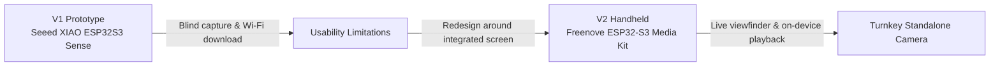

<div align="center">

# Aloe Camera · ESP32-S3 Digital Camera

### A custom embedded digital camera developed across two hardware generations with live LVGL viewfinder

[](https://www.espressif.com/)
[](mainCamera/)
[](https://lvgl.io/)
[](#how-v2-works)
[](#overview)

A standalone handheld digital camera featuring real-time ST7789 TFT display streaming, 5-way directional navigation, PSRAM caching, and local SD card image management.

[Project Overview](#overview) | [Hardware Evolution](#version-1-vs-version-2) | [System Architecture](#how-v2-works) | [Arduino Bring-Up](#v2-setup) | [Firmware Source](mainCamera/)

</div>

---

## Overview

**Aloe Camera** is a compact, custom embedded digital camera designed and developed by [Angelo James Demetroulakos](https://angelojamesny.com/). The project evolved across two distinct hardware generations: an ultra-minimal screenless prototype using the Seeed Studio XIAO ESP32S3 Sense, and a fully integrated handheld camera built on the Freenove ESP32-S3 Media Kit with a live color LCD viewfinder.

| System Parameter | Technical Specification |
| --- | --- |
| Main microcontroller | Espressif ESP32-S3 (Dual-core Xtensa LX7 @ 240 MHz, 8 MB Octal PSRAM) |
| Image sensor | OV2640 2-Megapixel CMOS camera module |
| User interface | 1.14" ST7789 IPS TFT display (135 × 240 pixels) powered by LVGL 8.4 |
| Physical navigation | 5-way tactile directional switch (Up, Down, Left, Right, Center Click) |
| Local storage | Removable MicroSD card via 4-bit high-speed SD_MMC bus |
| Power & battery | Integrated LiPo battery management with real-time ADC voltage telemetry |
| Active firmware | Complete 17-module Arduino C++ sketch in [`mainCamera/`](mainCamera/) |

> [!NOTE]
> **Status:** Version 2 represents the active, stable firmware baseline. The complete compilation and upload instructions are documented below.

## Version 1 vs. Version 2



| Feature / Subsystem | Version 1 (Prototype) | Version 2 (Production Handheld) |
| --- | --- | --- |
| Core board | Seeed Studio XIAO ESP32S3 Sense | Freenove ESP32-S3 Media Kit (FNK0102A) |
| Viewfinder | None (blind capture) | 1.14" Color IPS LCD (135 × 240) live preview |
| Image retrieval | Local Wi-Fi web server download | Direct MicroSD removal + on-screen playback |
| Image caching | Direct flash write | PSRAM high-speed frame buffer caching |
| User interface | Single physical push button + LED | Full LVGL graphical menus, icons, and status bar |
| Power telemetry | Unmonitored | Filtered ADC battery level and charge state indicator |

## How V2 Works

The firmware in [`mainCamera/`](mainCamera/) orchestrates hardware peripherals through high-performance non-blocking tasks:

1. **Hardware Initialization:** Boots the ESP32-S3, allocates frame buffers in 8 MB PSRAM, and mounts the MicroSD card over 4-bit `SD_MMC`.
2. **Graphical Rendering:** LVGL 8.4 and TFT_eSPI render responsive menus, status bars, and UI dialogs to the ST7789 panel.
3. **Capture Pipeline:** Pulls JPEG frames from the OV2640 sensor, renders live preview scaling to the screen, and writes full-resolution captures to `/DCIM/`.
4. **Playback Engine:** Decodes and scales stored images from MicroSD into PSRAM for fluid gallery browsing.
5. **Battery Monitor:** Continuously samples battery voltage through a software RC filter to provide a stable charge percentage display.

## V2 Setup & Flashing

### 01 / Prerequisites
- **Arduino IDE** (v2.0+)
- **ESP32 Arduino Core:** Version `3.0.7`
- **Libraries:** LVGL `8.4.0`, TFT_eSPI `2.5.43`, Freenove WS2812 `2.0.0`

### 02 / Board Configuration Settings

| Parameter | Required Arduino IDE Setting |
| --- | --- |
| Board | **ESP32S3 Dev Module** |
| CPU Frequency | **240 MHz (WiFi)** |
| Flash Mode | **QIO 80 MHz** |
| Flash Size | **16 MB (128 Mb)** |
| Partition Scheme | **16M Flash (2MB APP / 12.5MB FATFS)** |
| PSRAM | **OPI PSRAM** |

### 03 / Display Profile Selection

In `TFT_eSPI_Setups/User_Setup_Select.h`, ensure the 1.14-inch compact display macro is uncommented:

```cpp
#define FNK0102A_1P14_135x240_ST7789
//#define FNK0102B_3P5_320x480_ST7796
```

### 04 / Upload Procedure
1. Insert a FAT32-formatted MicroSD card into the slot.
2. Open [`mainCamera/mainCamera.ino`](mainCamera/mainCamera.ino) in Arduino IDE.
3. Select your serial COM port, compile, and upload.

## Repository Contents

```text
.
├── mainCamera/         # Complete 17-file Aloe Camera V2 Arduino C++ firmware
├── .gitattributes
├── .gitignore          # Build artifacts and local exclusions
└── README.md           # Engineering documentation and bring-up guide
```

---

<div align="center">

Designed and developed by **[Angelo James Demetroulakos](https://angelojamesny.com/)**

</div>
