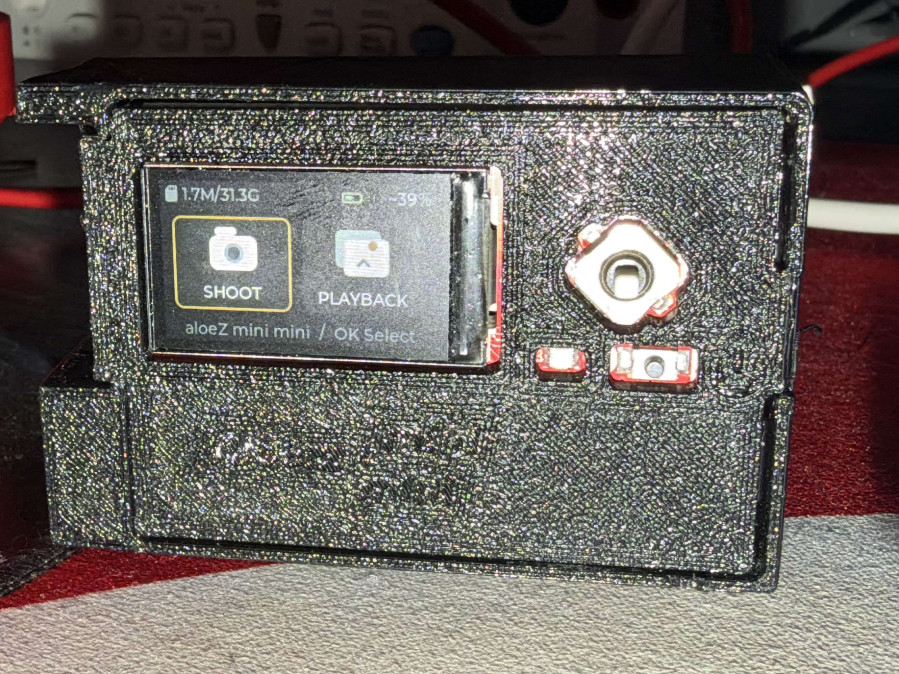
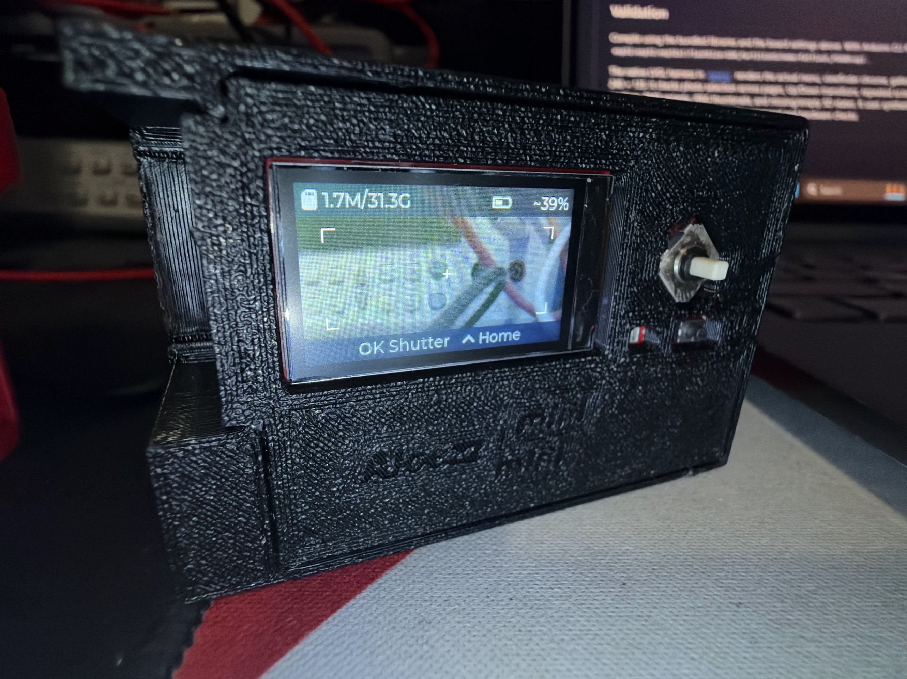
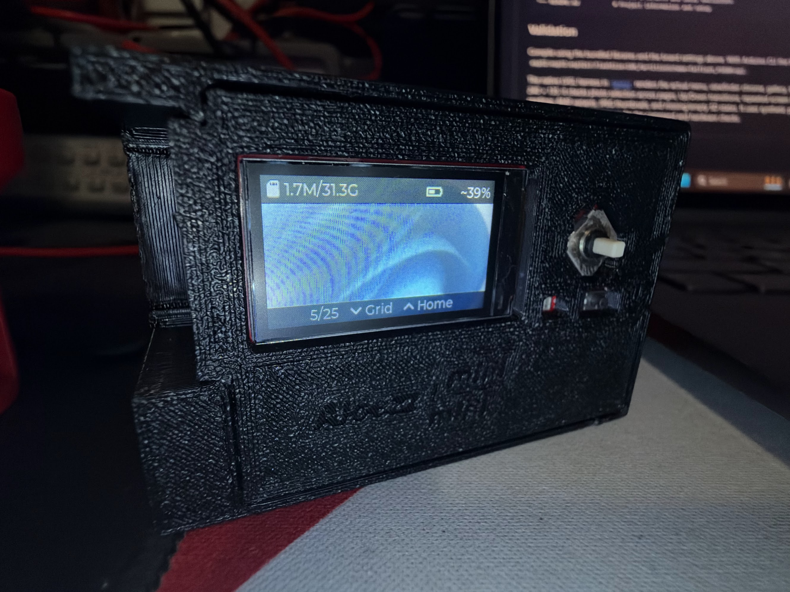
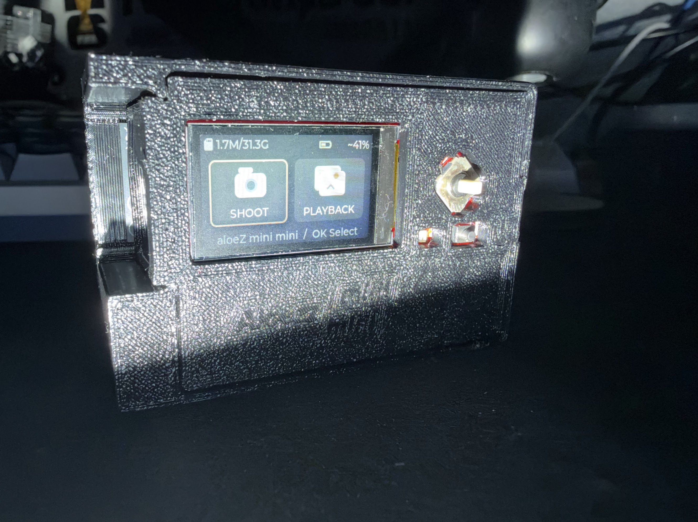

# aloeZ mini mini

An ESP32-S3 digital camera with a live viewfinder, photo gallery and 3D-printed enclosure.

[Setup](docs/setup.md) · [Controls](#controls) · [Hardware & CAD](docs/hardware.md) · [Docs](docs/README.md)

<table>
  <tr>
    <td width="50%"><picture></picture> <strong>Home</strong></td>
    <td width="50%"><picture></picture> <strong>Shooting</strong></td>
  </tr>
  <tr>
    <td><picture></picture> <strong>Photo playback</strong></td>
    <td><picture></picture> <strong>Printed enclosure</strong></td>
  </tr>
</table>

## Features

- Live viewfinder and quick capture to MicroSD.
- Single-photo playback and an eight-photo thumbnail grid.
- SD used / total space at the top left; live battery estimate at the top right.

Photos save as BMP files in `/picture/` at viewfinder resolution. Firmware is
uploaded over USB to onboard flash; the SD card holds photos and diagnostic logs.
Battery percentages marked `~` are voltage-based estimates and can change with
USB power. [Battery details →](docs/battery.md)

## Controls

| Screen | Left / Right | Down | Up | Center / OK |
| --- | --- | --- | --- | --- |
| Home | Select mode | — | — | Open |
| Shooting | — | — | Home | Take photo |
| Photo | Previous / next | Thumbnail grid | Home | — |
| Grid | Select photo / turn pages | — | Open photo | Open photo |

Playback starts at the newest numbered photo. From the grid, Up opens the
selected photo; another Up returns Home.

## Build

| Part | Model |
| --- | --- |
| Board | Freenove ESP32-S3 Media Kit FNK0102A, 1.14-inch display |
| Battery | KBT 883545PL, 3.7 V / 1500 mAh LiPo |

Use the bundled libraries and ESP32 Arduino core **3.3.11**. Open
[`mainCamera.ino`](mainCamera/mainCamera.ino) and upload through **USB UART**.
[Board settings and installation →](docs/setup.md)

> [!CAUTION]
> Check battery connector polarity before connecting it; mine needed correcting.
> [Parts, wiring notes and enclosure files →](docs/hardware.md)

## More

[STEP enclosure](CAD/aloez-mini-mini-full-case.step) ·
[Fusion 360 project](CAD/aloez-mini-mini-full-case.f3z) ·
[V2 demo](https://youtube.com/shorts/tKdeSfX_wso) ·
[Tests](tests/README.md) ·
[Battery test results](docs/battery-test-2026-10-17/report.md)
