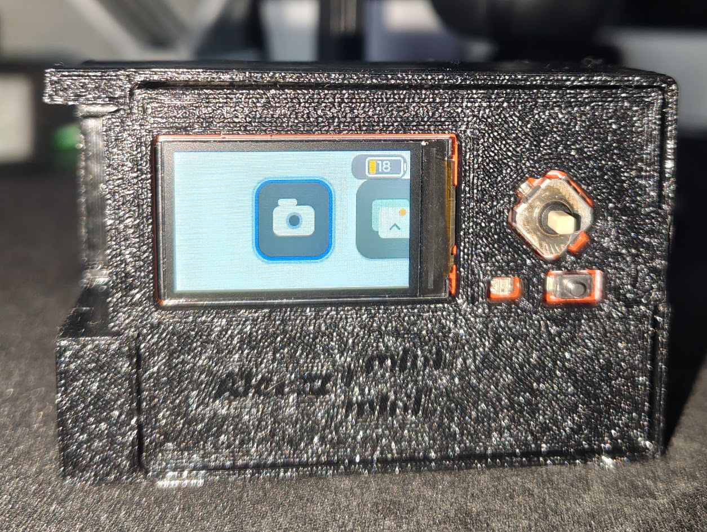

<div align="center">

# aloeZ mini mini

[](https://www.espressif.com/)
[](mainCamera/)
[](https://lvgl.io/)
[](#how-v2-works)



<strong>Quick navigation:</strong><br>
[Overview](#overview) | [Parts](#bill-of-materials) | [CAD](#cad-files) | [Photos and Videos](#photos-and-videos) | [V1 and V2](#v1-and-v2) | [Setup](#v2-setup-and-flashing) | [Code](mainCamera/)

</div>

---

## Overview

aloeZ mini mini is a small digital camera I made with an ESP32-S3. I built V1 first
as a screenless camera, then rebuilt it as V2 with a screen, controls, a battery,
and MicroSD storage. V2 is the final version and the one used in this repo.

The board specs, pinouts, and examples are in the [Freenove documentation](https://docs.freenove.com/projects/fnk0102/en/latest/index.html).
Freenove also has the original [code and board files on GitHub](https://github.com/Freenove/Freenove_Media_Kit_for_ESP32-S3).

## Bill of Materials

These are the parts I bought for V2. This does not include a 3D printer or
filament.

| Qty. | Part | Link |
| ---: | --- | --- |
| 1 | Freenove ESP32-S3 Media Kit, FNK0102A with the 1.14 inch screen | [Amazon](https://www.amazon.com/dp/B0F9L7SBWX) |
| 1 | KBT 883545PL 3.7 V 1500 mAh LiPo battery, about 45 × 35 × 8.8 mm | [Amazon](https://www.amazon.com/dp/B09SV2DF7K) |

> [!NOTE]
> Amazon links do not always stay up. If a link stops working, search for the
> model and specs in the table.

> [!CAUTION]
> The battery I bought had the red and black wires in the wrong positions for
> the Media Kit. I removed the contacts from the plug and swapped them. Check
> the polarity before plugging it in. Red goes to positive and black goes to
> negative or GND. The battery port takes 3.7 to 4.2 V. It is not the 5 V or
> 3.3 V header. Freenove has a [battery wiring diagram here](https://docs.freenove.com/projects/fnk0102/en/latest/fnk0102/codes/Main/Preface.html#battery-optional).

## CAD Files

I included the full case in two formats.

| Format | File |
| --- | --- |
| STEP | [`aloez-mini-mini-full-case.step`](CAD/aloez-mini-mini-full-case.step) |
| Fusion 360 archive | [`aloez-mini-mini-full-case.f3z`](CAD/aloez-mini-mini-full-case.f3z) |

Use the STEP file in most CAD programs. Use the F3Z file if you want the Fusion
360 version.

## Photos and Videos

<p align="center">
  
</p>

<p align="center"><em>V1 is on the left. V2 is on the right.</em></p>

| Version | Video |
| --- | --- |
| V1 | [YouTube Short](https://youtube.com/shorts/e1hyfsS4Pfs?si=TT9GlTVhTSVb_hjN) |
| V2 | [YouTube Short](https://youtube.com/shorts/tKdeSfX_wso?si=DUUyIVA3gJq0QIom) |

## Battery Readout

The installed battery is the **KBT 883545PL, 3.7 V, 1500 mAh** listed above.
The screen now marks its voltage-based charge estimate with `~`, for example
`~70%`. It samples live voltage without blocking the UI, discards noisy/invalid
windows, and settles after power changes. It no longer restores old percentages
or adds charge based on elapsed time. `--%` means unavailable or settling.

This board exposes battery voltage, not a fuel gauge or a software-readable
charging-status signal. USB charging and camera load change terminal voltage;
the percentage remains approximate until this particular board and cell are
measured. See [the circuit research and calibration procedure](docs/battery.md).
The board's blue LED remains the charging indicator.

## Camera Controls


| Screen | Left / Right | Down | Up | Center / OK |
| --- | --- | --- | --- | --- |
| Home | Select SHOOT / PLAYBACK | — | — | Open selection |
| Viewfinder | — | — | Home | Take a photo |
| Single photo | Previous / next photo | Square thumbnail grid | Home | — |
| Thumbnail grid | Previous / next thumbnail; pages automatically | Stay in grid | Open selected photo | Open selected photo |

Playback starts with the newest numbered photo. The grid contains eight square
thumbnails per page, with a gold selection outline. One Up press opens the
selected photo; the next Up press exits playback. Holding Up does not skip
through both levels. Unreadable images show an error; missing and empty cards
have their own messages.

The top-left SD icon shows **used / total SD filesystem space** on all screens,
including other files on the card. Small amounts use K (KB) or M (MB); larger
amounts and total capacity use G (GB). For example, `1.0M/31.3G` means about
1 MB used out of 31.3 GB. Nonzero usage no longer rounds down to `0.0 GB`.
Usage refreshes when a screen opens and after a capture completes. A nearly
full card turns the readout red.

Serial diagnostics at 115200 accept `storage` for exact SD, photo-folder and
onboard-flash byte counts. `battery start` begins a bounded SD voltage log that
resumes across power cycles, `battery mark <note>` adds a test-phase note,
`battery dump` exports it, and `battery stop` disarms it. See
[the unplugged test procedure](docs/battery.md#recording-an-unplugged-test).

## V1 and V2

### V1

V1 used a Seeed Studio XIAO ESP32S3 Sense. It had no screen, so I could not see
the photo before taking it. Photos were downloaded through a Wi-Fi page.
[Watch V1 here.](https://youtube.com/shorts/e1hyfsS4Pfs?si=TT9GlTVhTSVb_hjN)

### V2

V2 uses the Freenove ESP32-S3 Media Kit. I added a live viewfinder, menus,
physical controls, a gallery, MicroSD storage, and a battery. This is the final
version of the camera. [Watch V2 here.](https://youtube.com/shorts/tKdeSfX_wso?si=DUUyIVA3gJq0QIom)

## How V2 Works

The code is in [`mainCamera/`](mainCamera/).

- LVGL and TFT_eSPI run the menus and screen.
- The camera feed is scaled down for the live viewfinder.
- Photos are saved to `/picture/` on the MicroSD card (currently at viewfinder resolution).
- Saved photos can be opened from the gallery.
- The battery icon shows an approximate live voltage-based charge estimate.

## V2 Setup and Flashing

### 01 / Prerequisites
- **Arduino IDE** (v2.0+)
- **ESP32 Arduino Core:** Version `3.0.7` (the firmware is also compile-verified with `3.3.11`)
- **Libraries:** No separate download is required. Known-good copies of LVGL `8.4.0`, TFT_eSPI `2.5.43`, the FNK0102A display setup, and Freenove WS2812 `2.0.0` are committed in [`Freenove-Libraries/`](Freenove-Libraries/).

On Windows, install all bundled libraries into the Arduino sketchbook by
opening PowerShell in this repository and running:

```powershell
powershell -ExecutionPolicy Bypass -File .\install-arduino-libraries.ps1
```

The installer automatically uses the OneDrive Documents location when it is
present, preserves existing library folders in a backup directory, and installs
the exact bundled versions. Restart Arduino IDE afterward. To use a custom
Arduino sketchbook location, pass `-SketchbookPath "C:\path\to\Arduino"`.

For manual installation, use **Sketch > Include Library > Add .ZIP Library**
and add every ZIP in [`Freenove-Libraries/`](Freenove-Libraries/) in this order:
`lvgl.zip`, `TFT_eSPI_Setups.zip`, `TFT_eSPI.zip`, then
`Freenove_WS2812_Lib_for_ESP32.zip`.

The archives came from the official [Freenove ESP32-S3 Media Kit
repository](https://github.com/Freenove/Freenove_Media_Kit_for_ESP32-S3/tree/main/Libraries).
The bundled `TFT_eSPI_Setups.zip` differs only by selecting the
`FNK0102A_1P14_135x240_ST7789` display profile.

| Library archive | Version | SHA-256 |
| --- | --- | --- |
| `lvgl.zip` | 8.4.0 | `d687a7cec1466743e9d1b9c7f4f4b033a9121a17d8d5d0ae6461eeb284e84f20` |
| `TFT_eSPI.zip` | 2.5.43 | `b471fc7af1daecd8b022f8e2ec4ca3da8301564676c9e3b6986e51ff2762787b` |
| `TFT_eSPI_Setups.zip` | FNK0102A profile | `05aae81c0afc69e1ab3ce5b5d4d30972d0c9343296c413f8866c28b612eb3fc4` |
| `Freenove_WS2812_Lib_for_ESP32.zip` | 2.0.0 | `9fe4003730d85ef5e9e8f2ed707b57825b62c36e1e1d53409c07feb2c756e7a2` |

### 02 / Board Configuration Settings

| Parameter | Required Arduino IDE Setting |
| --- | --- |
| Board | **ESP32S3 Dev Module** |
| CPU Frequency | **240 MHz (WiFi)** |
| Flash Mode | **QIO 80 MHz** |
| Flash Size | **16 MB (128 Mb)** |
| Partition Scheme | **16M Flash (2MB APP / 12.5MB FATFS)** |
| PSRAM | **OPI PSRAM** |

### 03 / Display Profile Selection

The bundled setup already selects the 1.14-inch FNK0102A display. If using a
separately downloaded Freenove setup, ensure only this compact-display macro is
uncommented in `TFT_eSPI_Setups/User_Setup_Select.h`:

```cpp
#define FNK0102A_1P14_135x240_ST7789
//#define FNK0102B_3P5_320x480_ST7796
```

### Where the firmware lives

Firmware is uploaded over USB into the ESP32-S3 module's onboard SPI flash.
The MicroSD card stores photos in `/picture/`; it is not the firmware target.
This sketch has no SD-card firmware updater. The **Flash Size** and **Partition
Scheme** settings describe onboard flash, separately from the SD capacity.
An SD card is needed for taking/saving photos, not for uploading firmware.
Mount failures never trigger automatic formatting.

### 04 / Upload Procedure
1. Insert a FAT32-formatted MicroSD card into the slot.
2. Open [`mainCamera/mainCamera.ino`](mainCamera/mainCamera.ino) in Arduino IDE.
3. Select your serial COM port, compile, and upload.

## Repository Contents

```text
.
├── CAD/                # STEP export and Autodesk Fusion enclosure archive
├── docs/images/        # Camera photos
├── mainCamera/         # Arduino code for V2
├── Freenove-Libraries/ # Libraries used by the code
├── install-arduino-libraries.ps1
├── .gitattributes
├── .gitignore          # Build artifacts and local exclusions
└── README.md           # Project information and setup
```

## Validation

Compile using the bundled libraries and the board settings above. With Arduino
CLI the board options are `esp32:esp32:esp32s3:FlashSize=16M,PartitionScheme=fatflash,PSRAM=opi`.

The native LVGL harness in [`tests/`](tests/) renders the actual menu, viewfinder
chrome, gallery, battery, and storage UI at 240 × 135. It checks photo selection
across pages, Up/Down transitions, repeated screen teardown, invalid battery
readings, BMP variants, JPEG thumbnails, and missing/empty SD states. It uses
synthetic photos in a temporary directory. See [`tests/README.md`](tests/README.md)
for the command and hardware checks.
