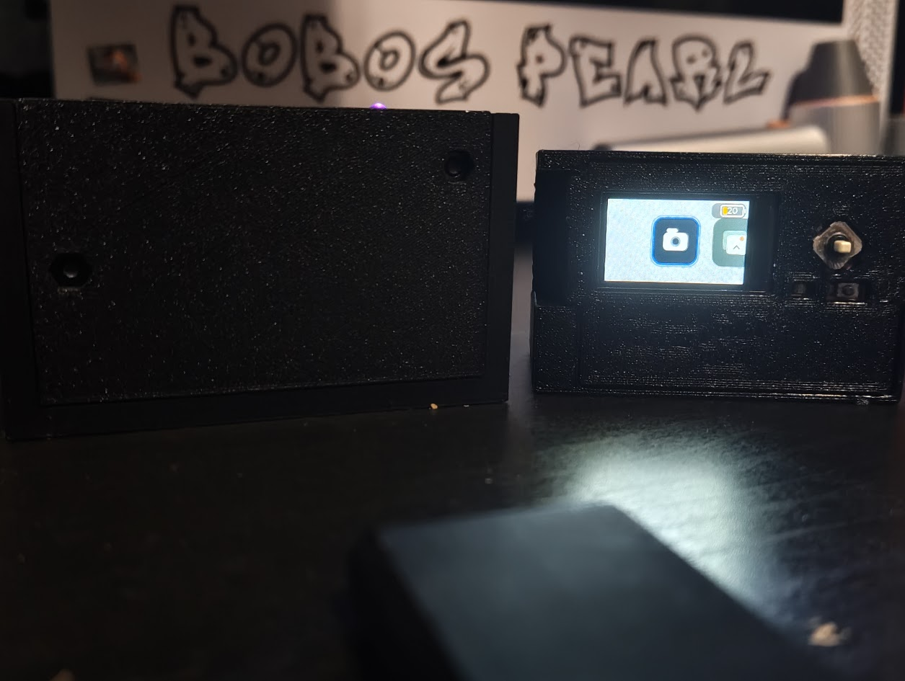

# Hardware and enclosure

[← Project](../README.md) · [Documentation](README.md)

## Parts

| Qty. | Part | Link |
| ---: | --- | --- |
| 1 | Freenove ESP32-S3 Media Kit FNK0102A, 1.14-inch screen | [Amazon](https://www.amazon.com/dp/B0F9L7SBWX) |
| 1 | KBT 883545PL, 3.7 V / 1500 mAh LiPo, about 45 × 35 × 8.8 mm | [Amazon](https://www.amazon.com/dp/B09SV2DF7K) |

A 3D printer and filament are also needed for the enclosure. If a listing
changes, search by model and dimensions.

> [!CAUTION]
> My battery's connector polarity was reversed for the Media Kit and needed
> correcting. Check polarity before connecting yours: positive to positive,
> negative to GND. Use the battery port, not the 5 V or 3.3 V header. See
> [Freenove's wiring guide](https://docs.freenove.com/projects/fnk0102/en/latest/fnk0102/codes/Main/Preface.html#battery-optional).

## Enclosure files

[STEP model](../CAD/aloez-mini-mini-full-case.step) ·
[Fusion 360 archive](../CAD/aloez-mini-mini-full-case.f3z)

Use STEP in most CAD programs or F3Z for the Fusion 360 project.

## V1 and V2

V1 used a Seeed Studio XIAO ESP32S3 Sense with a Wi-Fi photo download page.
V2 uses the Freenove Media Kit with a display, physical controls, battery and gallery.

[Watch V1](https://youtube.com/shorts/e1hyfsS4Pfs) ·
[Watch V2](https://youtube.com/shorts/tKdeSfX_wso)

Board reference: [Freenove documentation](https://docs.freenove.com/projects/fnk0102/en/latest/index.html)
and [original examples and schematics](https://github.com/Freenove/Freenove_Media_Kit_for_ESP32-S3).
