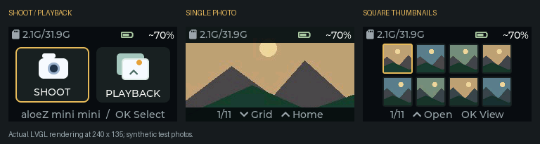

# Firmware and UI checks

[← Project](../README.md) · [Documentation](../docs/README.md)

<picture></picture>

## Native LVGL check

Requirements: Zig 0.14.1 (native C/C++ compiler), Python with Pillow, and the
bundled LVGL 8.4.0 extracted with `install-arduino-libraries.ps1` into a temporary
sketchbook. No real SD card or connected camera is accessed.

```powershell
./tests/run-native.ps1 -ZigPath 'C:/path/to/zig.exe' -LvglPath 'C:/temp/sketchbook/libraries/lvgl' -PythonPath 'C:/path/to/python.exe'
```

The harness compiles production UI and decoding code against a simulated SD
filesystem and ADC. It writes actual 240 x 135 PPM renderings to
`$env:TEMP/digital-camera-native` (override with `-OutputPath`). It does not model
camera hardware, ADC electrical behavior, display transfer speed, or FreeRTOS
concurrency.

## Hardware checks after uploading

- SHOOT: live view; Center takes a photo; Saved appears only after a complete
  write. Up returns home even after capture errors.
- PLAYBACK: newest photo; Down opens eight square thumbnails. Left/Right crosses
  page boundaries. Up opens the selected photo; another Up returns home. Hold
  Up and confirm one transition per physical press.
- Repeat SHOOT/Home and PLAYBACK/Home, including exiting during thumbnail
  loading. Check responsiveness and available heap.
- Check old/new camera BMPs and baseline JPEGs for correct orientation/color.
  Unsupported/progressive JPEGs should show an error.
- Check missing, empty, full and unreadable cards. No automatic formatting.
  SD usage uses decimal K/M/G units and refreshes after saving.
- Compare logged voltages with multimeter readings in both power states before
  trusting charge estimates. Follow the [battery guide](../docs/battery.md).

The native harness also checks adaptive K/M/G storage formatting (including a
single nonzero byte), separate SD/photo/ESP storage reports, battery-log start,
append, resume, markers, export, stop, size limits and missing-card behavior.
